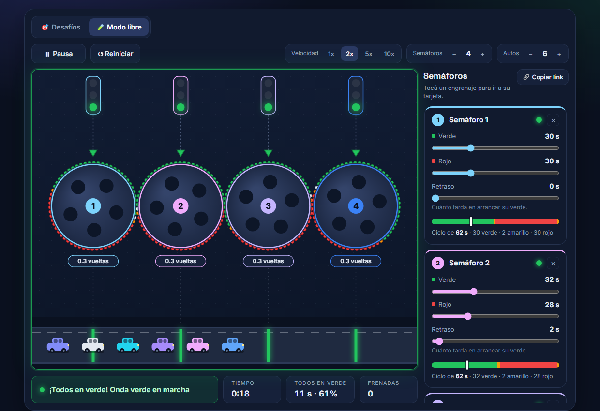
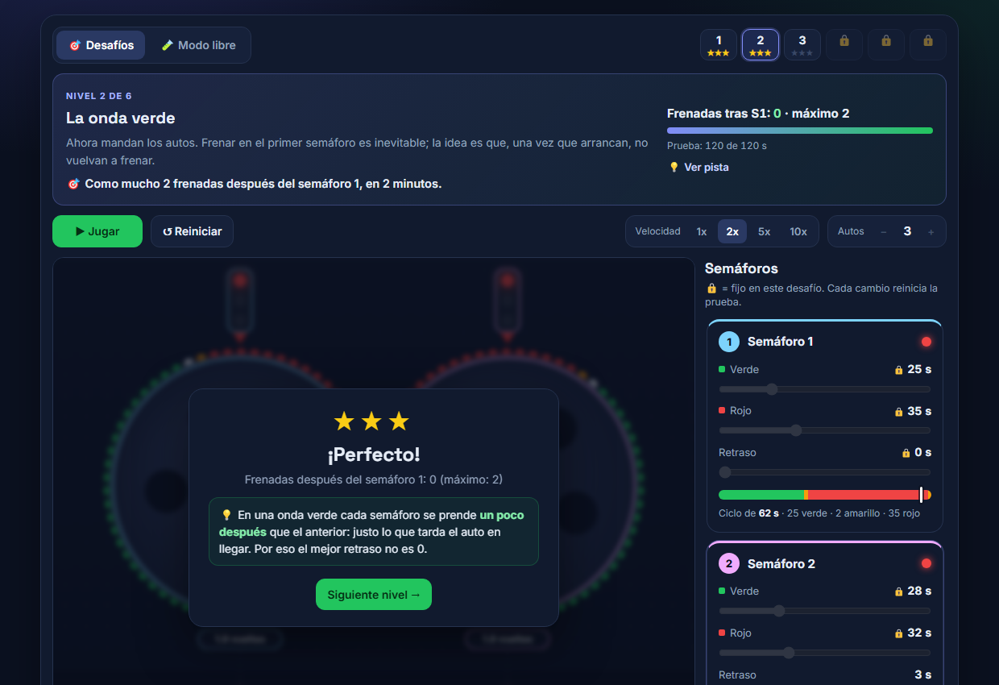

# 🚦⚙️ La onda verde, con engranajes

**Cada semáforo es un engranaje. Cada diente, un segundo de luz.** 
Desfasalos, sincronizalos y hacé que los autos crucen la avenida sin frenar.

---

## 💡 La idea

¿Por qué en algunas avenidas encontrás todos los semáforos en verde y en otras frenás en cada esquina? La respuesta es **el desfase** entre cruces.

Esta demo lo muestra de una forma que se puede tocar: cada semáforo es un engranaje con sus dientes pintados de verde, amarillo y rojo. Una flecha fija arriba lee el diente que pasa por debajo, y ese color se prende en el semáforo. Abajo, una calle con autos muestra el resultado: o pasan de largo, o hacen fila.

## 🎮 Cómo se juega

### 🎯 Desafíos

Seis niveles que se desbloquean de a uno. Cada uno enseña una idea y se gana mirando: corre el reloj, se llena la barra y, si cumpliste la meta, ganás de ⭐ a ⭐⭐⭐.

| Nivel | Desafío | Lo que aprendés |
|:---:|---|---|
| 1 | 🤝 **Primer encuentro** | Con el mismo ciclo, sincronizar es desfasar |
| 2 | 🌊 **La onda verde** | El mejor retraso es lo que tarda el auto en llegar, no 0 |
| 3 | 🥁 **Ritmos distintos** | Con ciclos distintos, cualquier coincidencia se desarma |
| 4 | 🚥 **Tres en fila** | Los desfases se acumulan de cruce en cruce |
| 5 | ↔️ **La otra calle** | La calle transversal también necesita su verde |
| 6 | 🏙️ **Hora pico** | Seis cruces y diez autos: todo junto |

### 🧪 Modo libre

De 2 a 6 semáforos y de 1 a 10 autos, con verde, rojo y retraso ajustables en vivo. Cada configuración se puede **compartir con un link** 🔗.

## ⚙️ Cómo funciona

- 🦷 **Un diente = un segundo.** Más tiempo de ciclo, engranaje más grande.
- 🔄 **Los engranajes vecinos giran al revés**, como piezas que encastran de verdad.
- 🎯 **La flecha decide el color**, no el punto de contacto entre engranajes.
- 🟢 **Sincronizado** es cuando todas las flechas leen verde al mismo tiempo.

## 🚀 Probarla

- 💻 **En tu compu:** descargá el repo y abrí `index.html` en el navegador. No hace falta instalar nada.
- 🌐 **Online:** próximamente en GitHub Pages.

## 🛠️ Detalles técnicos

- Un único `index.html` con HTML, CSS y JavaScript, dibujado en `<canvas>` y sin librerías.
- La lógica de los engranajes está portada del simulador original en Python y **validada contra él** segundo a segundo, incluso en los bordes de cada diente.
- Funciona en computadora y en celular.

## 🧭 Sobre el proyecto

Esta es una versión simplificada, pensada para jugar y aprender, de un simulador de sincronización de semáforos más completo (Python) que sigo desarrollando por separado e incluye análisis de sincronización y proyecciones.

## 📄 Licencia

[MIT](LICENSE) © 2026 Marcos Butti
